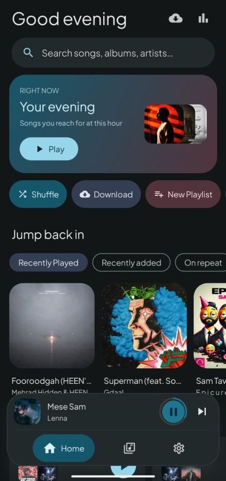
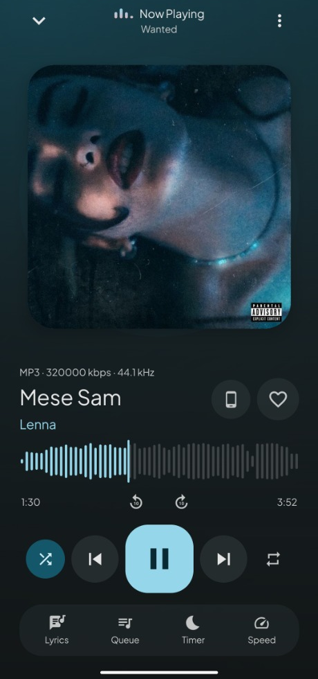
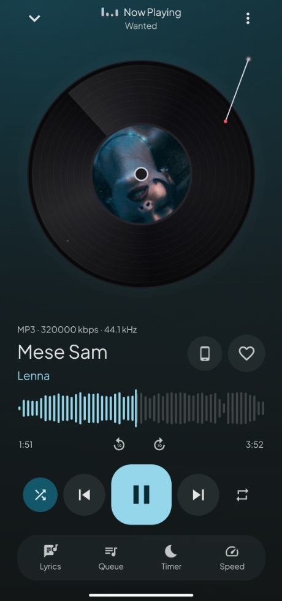
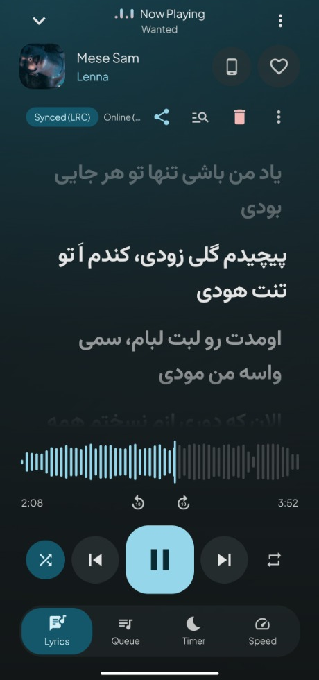
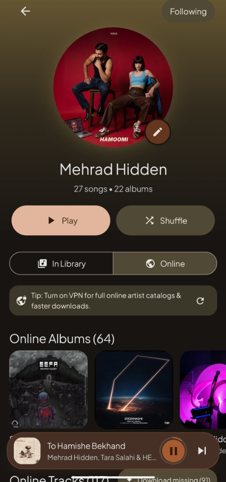
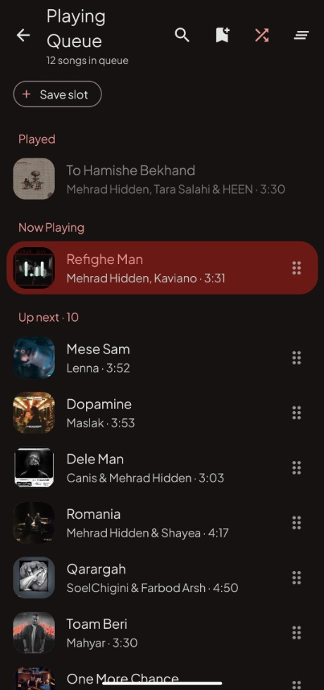
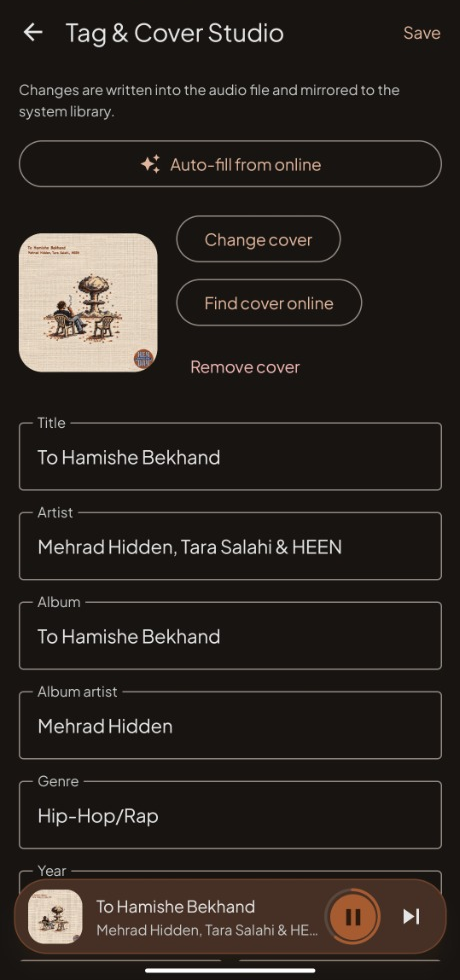
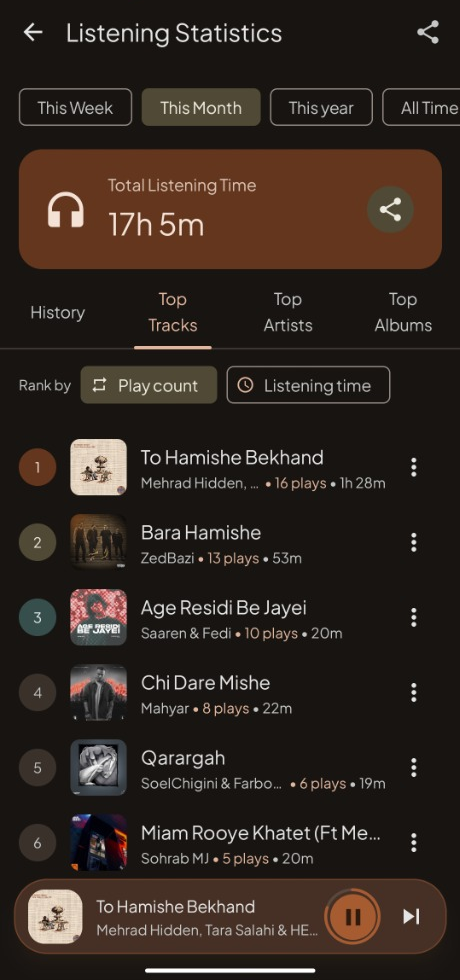

<div align="center">


# LogaRhythm

پخش‌کنندهٔ موسیقی آفلاین برای اندروید<br>
بدون حساب کاربری، بدون اشتراک و بدون تبلیغ؛ آهنگ‌های شما روی گوشی خودتان می‌ماند

<a href="https://github.com/Yasinjahantigh/LogaRhythm-Android/releases/latest"></a>
<a href="https://github.com/Yasinjahantigh/LogaRhythm-Android/releases"></a>
<a href="https://logarhythm-installs.yasinjahantigh.workers.dev/stats"></a>
<a href="https://t.me/LogaRhythmApp"></a>
<a href="https://daramet.com/yasinjahantigh"></a>


[English](README.md) · فارسی

</div>

<p align="center">
  
  
  
</p>
<p align="center">
  
  
  
</p>
<p align="center">
  
  
  
</p>

<div dir="rtl">

## LogaRhythm چیست؟

LogaRhythm موسیقی‌های روی گوشی خودتان را پخش می‌کند. پلی‌لیست‌ها، تاریخچه، تگ‌ها و متن ترانه‌ها همگی روی دستگاه خودتان می‌مانند و جایی آپلود نمی‌شوند.

امکانات آنلاین مثل دانلود آهنگ، متن ترانه، رادار انتشار و هوش مصنوعی فقط وقتی کار می‌کنند که خودتان بخواهید. غیر از این‌ها، برنامه فقط دو کار کوچک در پس‌زمینه انجام می‌دهد: روزی یک بار چک می‌کند نسخهٔ جدیدی در گیت‌هاب آمده یا نه، و در اولین اجرا یک بار به‌صورت ناشناس نصب را می‌شمارد (شناسهٔ تصادفی، نسخهٔ برنامه، مدل گوشی و نسخهٔ اندروید؛ در آپدیت‌ها دیگر تکرار نمی‌شود).

## امکانات برنامه

### پخش و پلیر
- **پخش بی‌پایان**: وقتی صف پخش به آخر نزدیک می‌شود، برنامه خودش آهنگ‌های مشابه از کتابخانه‌تان را به ادامهٔ صف اضافه می‌کند تا موسیقی قطع نشود.
- **حالت گرامافون**: با کشیدن به چپ و راست سراغ آهنگ بعدی یا قبلی بروید تا صفحه از داخل کاور مقوایی بیرون بیاید؛ اگر انگشت را کمی روی صفحه نگه دارید یا از لبه بچرخانید، می‌توانید آهنگ را مثل یک گرامافون واقعی عقب و جلو ببرید.
- **کنترل کامل صدا**: کراس‌فید، رد کردن سکوت، سرعت جداگانه برای هر آهنگ، تغییر گام، حالت Slowed + Reverb، لوپ A–B، تایمر خواب، ReplayGain، اکولایزر ۵ بانده، تقویت باس، بالانس چپ/راست، حالت مونو و اکولایزر خودکار مخصوص هر هدفون.
- **حالت خودرو و ویجت‌ها**: حالت خودرو خوانا (عمودی و افقی) به‌همراه ۵ ویجت صفحهٔ اصلی، از کاور کوچک ۲×۲ تا پلیر ۴×۴ با صف پخش.

### صف پخش و کتابخانه
- **صف پخش سه‌بخشی**: آهنگ‌های پخش‌شده، آهنگ فعلی و آهنگ‌های بعدی — با جابه‌جایی کشیدنی، حذف با سوایپ و امکان ذخیرهٔ چند صف مختلف.
- **مدیریت راحت کتابخانه**: هر آهنگ را به راست بکشید تا به‌عنوان آهنگ بعدی پخش شود؛ پوشه‌های دلخواه را جدا یا حذف کنید و هر وقت خواستید با حالت خصوصی، ثبت تاریخچه را موقتاً ببندید.
- **صفحهٔ خواننده با عکس و تب آنلاین**: عکس خواننده‌ها خودکار آنلاین پیدا می‌شود (و اگر اشتباه بود می‌توانید از گالری یا جستجوی آنلاین عوضش کنید). در تب آنلاین هم آهنگ‌های خواننده را ببینید، گوش دهید و آن‌هایی که روی گوشی ندارید دانلود کنید.
- **رادار انتشار**: خواننده‌های محبوبتان را دنبال کنید تا آهنگ‌های جدیدشان را همراه با تاریخ انتشار در صفحهٔ خانه ببینید، با یک لمس دانلود کنید یا آن‌هایی را که نمی‌خواهید با دکمهٔ × ببندید.

### متن ترانه و کارت اشتراک‌گذاری
- **متن همگام**: متن داخل فایل و `.lrc` را می‌خواند یا از اینترنت پیدا می‌کند (LRCLIB، NetEase، Kugou، lyrics.ovh و Genius) و ویرایشگر زمان‌بندی LRC هم دارد.
- **ساخت کارت با پیش‌نمایش زنده**: از هر آهنگ، خطوط دلخواه متن ترانه یا گزارش شنیداری خودتان عکس بسازید. قبل از اشتراک‌گذاری می‌توانید تم، رنگ، سایز (مربعی، عمودی، استوری) و اندازهٔ متن را تغییر دهید.

### مرتب کردن تگ‌ها و کاور آهنگ‌ها
- **اصلاح خودکار تگ و کاور**: اسم‌های به‌هم‌ریختهٔ سایت‌های دانلود را تمیز می‌کند و عنوان، خواننده، آلبوم و کاور باکیفیت را دانه‌به‌دانه از Deezer، iTunes، MusicBrainz، رادیوجوان و MusicMan پیدا می‌کند.
- **ویرایشگر تگ و برش صدا**: تگ فایل‌های MP3، FLAC، OGG و M4A را بدون آسیب به فایل اصلی ویرایش کنید، یا بخش دلخواه آهنگ را ببرید و زنگ گوشی بگذارید.

### آمار گوش دادن
- تاریخچهٔ پخش و برترین آهنگ‌ها، خواننده‌ها و آلبوم‌هایتان را در بازهٔ هفتگی، ماهانه، سالانه یا تاریخ دلخواه ببینید.
- برترین‌ها را هم می‌توانید بر اساس **تعداد پخش** مرتب کنید و هم بر اساس **مدت زمان گوش دادن (دقیقه)**، و از آن کارت گرافیکی بگیرید.

### دانلود آهنگ و هوش مصنوعی اختیاری
- جست‌وجو، پیش‌نمایش و دانلود تک‌آهنگ، آلبوم یا پلی‌لیست از MusicMan، رادیوجوان، یوتیوب و ساندکلاد همراه با تگ و کاور خودکار.
- ساخت پلی‌لیست با هوش مصنوعی (Gemini یا سرویس‌های سازگار با OpenAI) — به‌صورت پیش‌فرض خاموش است و کلید شما فقط روی گوشی خودتان می‌ماند.

### ظاهر و شخصی‌سازی
- رنگ برنامه به‌صورت پیش‌فرض با **کاور آهنگ در حال پخش** هماهنگ می‌شود؛ البته می‌توانید سراغ تم تاریک، مشکی OLED، رنگ والپیپر یا رنگ دلخواه خودتان هم بروید.
- فونت پیش‌فرض **وزیرمتن** است و در کنار آن، ترکیب‌های آمادهٔ فارسی و انگلیسی، فونت سیستم و امکان وارد کردن هر فایل فونت `.ttf` یا `.otf` هم وجود دارد.
- فارسی و انگلیسی کامل، تنظیمات دسته‌بندی‌شده و مرتب، چیدمان مناسب تبلت، پشتیبان‌گیری یک‌فایلی و آپدیت خودکار از گیت‌هاب.

> برای جزئیات فنی هر بخش، [docs/FEATURES.fa.md](docs/FEATURES.fa.md) را ببینید.

## نصب

- اندروید 8.0 به بالا. بیشتر گوشی‌ها به نسخهٔ `arm64-v8a` نیاز دارند.
- فایل APK را از [گیت‌هاب](https://github.com/Yasinjahantigh/LogaRhythm-Android/releases/latest) یا [کانال تلگرام](https://t.me/LogaRhythmApp) بگیرید.
- بعد از اولین نصب، برنامه خودش نسخه‌های جدید را پیدا می‌کند و فایل مناسب گوشی شما را برای نصب آماده می‌کند.

## ساخت از سورس

```bash
git clone https://github.com/Yasinjahantigh/LogaRhythm-Android.git
cd LogaRhythm-Android
./gradlew :app:assembleDebug
```

- به JDK 17+ و Android SDK (compileSdk 36) نیاز دارد.
- شمارهٔ نسخه از تگ گیت (`vX.Y.Z`) خوانده می‌شود.
- اگر دسترسی به Google Maven محدود است، `logarhythm.mirrors=true` را به `local.properties` اضافه کنید.
- مراحل انتشار نسخه در [docs/RELEASING.md](docs/RELEASING.md) آمده است.

## حریم خصوصی

- موسیقی، پلی‌لیست‌ها، تاریخچه، تگ‌ها و متن ترانه‌ها روی گوشی خودتان می‌مانند.
- بخش‌های آنلاین فقط وقتی خودتان بزنید به اینترنت وصل می‌شوند.
- بدون حساب کاربری، بدون تبلیغ، بدون SDK ردیابی و بدون گزارش کرش.
- اولین اجرا یک بار به‌صورت ناشناس نصب را ثبت می‌کند (شناسهٔ تصادفی، نسخهٔ برنامه، مدل گوشی، نسخهٔ اندروید و پردازنده). آمار عمومی: [stats](https://logarhythm-installs.yasinjahantigh.workers.dev/stats).

## اجزای ثالث

- بخش دانلود از [youtubedl-android](https://github.com/junkfood02/youtubedl-android) و [yt-dlp](https://github.com/yt-dlp/yt-dlp) (مجوز GPL-3.0) استفاده می‌کند. جزئیات در [THIRD_PARTY_NOTICES](THIRD_PARTY_NOTICES).
- فونت‌های همراه برنامه (وزیرمتن، Plus Jakarta Sans، Space Grotesk، Playfair Display، JetBrains Mono، لاله‌زار، Noto Kufi Arabic و Noto Naskh Arabic) با مجوز SIL OFL 1.1 هستند: [OFL.txt](app/src/main/assets/OFL.txt).

## حمایت مالی (Donate)

اگر LogaRhythm برایتان کاربردی بوده، می‌توانید از ادامهٔ توسعهٔ آن حمایت کنید:

- **دارمت (کارت‌های بانکی ایران):** https://daramet.com/yasinjahantigh
- **رمزارز GRAM (شبکه TON):** `UQD-le1G2GZN7rF8PE0PKZ6BeyqKGDqaby6IZvcmw5VgLNZj`

## مجوز

Apache License 2.0 — [LICENSE](LICENSE).

باگ، ایده یا پیشنهادی دارید؟ یک issue باز کنید یا به [@LogaRhythmApp](https://t.me/LogaRhythmApp?direct) پیام بدهید.

</div>
