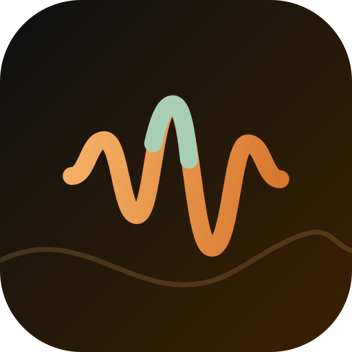
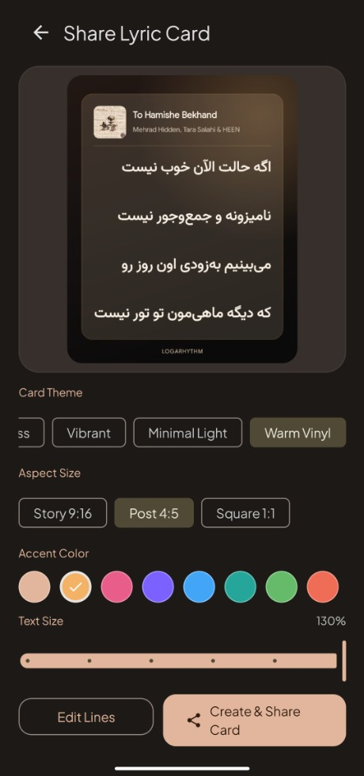

<div align="center">



# LogaRhythm

پخش‌کنندهٔ موسیقی آفلاین برای اندروید  
بدون تبلیغ، بدون حساب کاربری و بدون ردیابی رفتار شما؛ کتابخانهٔ موسیقی روی گوشی خودتان می‌ماند.

<a href="https://github.com/Yasinjahantigh/LogaRhythm-Android/releases/latest"></a>
<a href="https://github.com/Yasinjahantigh/LogaRhythm-Android/releases"></a>
<a href="https://logarhythm-installs.yasinjahantigh.workers.dev/stats"></a>
<a href="https://t.me/LogaRhythmApp"></a>


[English](README.md) · فارسی · [فهرست کامل امکانات](docs/FEATURES.fa.md)

</div>

<p align="center">
  
  
  
</p>
<p align="center">
  
  
  
</p>
<p align="center">
  
  
  
</p>

<div dir="rtl">

## دربارهٔ برنامه

LogaRhythm برای گوش دادن به فایل‌های موسیقی روی گوشی (MP3، FLAC، M4A و OGG) ساخته شده است. پلی‌لیست‌ها، صف‌های پخش، تاریخچه، تگ‌ها و متن ترانه‌ها همگی روی دستگاه خودتان نگه داشته می‌شوند.

امکانات آنلاین مثل دانلود آهنگ، پیدا کردن متن ترانه، ترجمه متن، رادار انتشار و ساخت پلی‌لیست با هوش مصنوعی فقط زمانی کار می‌کنند که خودتان سراغشان بروید.

## امکانات اصلی

### پخش و کنترل صدا
- **حالت گرامافون و کاور معمولی**: با کشیدن به چپ و راست، صفحهٔ جدید از داخل جلد مقوایی بیرون می‌آید؛ با نگه داشتن انگشت روی صفحه یا کشیدن لبهٔ آن می‌توانید آهنگ را دقیق جلو و عقب ببرید.
- **تنظیمات صدا**: کراس‌فید، رد کردن سکوت، ReplayGain (با Preamp)، اکولایزر ۵ بانده، تقویت باس، Virtualizer، بالانس چپ و راست، حالت مونو، اکولایزر خودکار برای هر هدفون، تغییر سرعت و گام، حالت **Slowed + Reverb**، لوپ A–B و تایمر خواب (بر اساس زمان، تعداد آهنگ یا پایان آهنگ فعلی).
- **صف پخش و خروجی صدا**: صف پخش سه‌بخشی (پخش‌شده، در حال پخش و بعدی)، کشیدن به راست برای پخش به‌عنوان آهنگ بعدی، ذخیرهٔ چند صف، پخش بی‌پایان از کتابخانهٔ خودتان، و انتخاب مستقیم دستگاه خروجی صدا از داخل پلیر.
- **حالت خودرو و ویجت‌ها**: حالت خودرو خوانا (عمودی و افقی) و ۵ ویجت صفحهٔ اصلی (`2×2`، `4×1`، `4×2`، `4×4` صف پخش و `4×4` کاور تمام‌صفحه).

### خانه، پلی‌لیست‌ها و دانلود
- **صفحهٔ خانه**: شبکهٔ دسترسی سریع در بالای صفحه، کارت متناسب با ساعت روز، میکس‌های روزانه، میکس حال‌وهوا و بخش رادار انتشار برای خواننده‌های دنبال‌شده.
- **پلی‌لیست و کتابخانه**: جستجو درون پلی‌لیست‌ها، سنجاق کردن پلی‌لیست‌های فیوریت، حذف مستقیم آهنگ از منوی پلیر، فیلتر یا لیست سفید پوشه‌ها و حالت خصوصی (توقف موقت ثبت تاریخچه).
- **دانلود و رادار انتشار**: جستجو و دانلود تک‌آهنگ یا آلبوم از MusicMan، رادیوجوان، Deezer، Saavn، یوتیوب، ساندکلاد و Bandcamp با انتخاب خودکار سریع‌ترین منبع بر اساس وضعیت VPN، پشتیبانی از `cookies.txt` برای یوتیوب، پنجرهٔ جزئیات با لمس کاور، مخفی‌سازی آهنگ‌هایی که از قبل روی گوشی دارید و رادار انتشار با تاریخ دقیق از iTunes و Deezer.

### متن ترانه، ترجمه و کارت اشتراک‌گذاری
- **متن ترانه**: خواندن متن داخل فایل و `.lrc` یا دریافت آنلاین از LRCLIB، Genius، NetEase، Kugou، lyrics.ovh و آدرس دلخواه، همراه با ویرایشگر زمان‌بندی LRC.
- **ترجمه رایگان دوزبانه**: ترجمه خط‌به‌خط متن ترانه بدون نیاز به کلید API و با ذخیرهٔ آفلاین، به‌همراه انیمیشن ملایم در بخش‌های بی‌کلام و سکوت.
- **ساخت کارت اشتراک‌گذاری**: خروجی تصویری برای آهنگ، خطوط متن یا گزارش شنیداری در سایزهای `1:1`، `4:5` و `9:16` با پیش‌نمایش زندهٔ تم، رنگ و اندازهٔ متن.

### ابزارهای کتابخانه و آمار شنیداری
- **اصلاح تگ، تشخیص تکراری و برش صدا**: ویرایش تگ MP3، FLAC، M4A و OGG با نوشتن امن روی فایل موقت، اصلاح دسته‌ای اسم‌ها و کاورهای شلوغ از Deezer، iTunes، MusicBrainz، رادیوجوان و MusicMan، پیدا کردن فایل‌های تکراری و برش آهنگ برای زنگ گوشی.
- **آمار آفلاین**: برترین آهنگ‌ها، خواننده‌ها و آلبوم‌ها در هر بازهٔ دلخواه بر اساس تعداد پخش یا دقیقهٔ گوش دادن.

### ظاهر، فونت و پشتیبان‌گیری
- **تم و فونت**: هماهنگی خودکار رنگ با کاور آهنگ به‌صورت پیش‌فرض، ۱۰ تم آماده، مشکی خالص OLED، رنگ والپیپر اندروید، ساخت تم با عکس پس‌زمینه، فونت پیش‌فرض وزیرمتن و امکان وارد کردن فونت دلخواه (`.ttf` / `.otf`) با پشتیبانی کامل از فارسی و انگلیسی و چیدمان تبلت.
- **بکاپ و هوش مصنوعی اختیاری**: پشتیبان‌گیری یک‌فایلی، خروجی/ورودی M3U و ساخت پلی‌لیست با Gemini یا API سازگار با OpenAI (پیش‌فرض خاموش و کلید رمزنگاری‌شده در KeyStore).

> توضیح کامل همهٔ بخش‌ها در [docs/FEATURES.fa.md](docs/FEATURES.fa.md) آمده است.

## نصب

قابل نصب روی **اندروید ۸.۰ به بالا**. بیشتر گوشی‌های جدید به نسخهٔ `arm64-v8a` نیاز دارند.

- [دانلود آخرین نسخه از گیت‌هاب](https://github.com/Yasinjahantigh/LogaRhythm-Android/releases/latest)
- [دریافت فایل نصب از کانال تلگرام (@LogaRhythmApp)](https://t.me/LogaRhythmApp)

## ساخت از سورس

نیازمند JDK 17 یا 21 و Android SDK Platform 35 (`minSdk = 26`, `targetSdk = 35`).

```bash
git clone https://github.com/Yasinjahantigh/LogaRhythm-Android.git
cd LogaRhythm-Android

# ساخت نسخه دیباگ
./gradlew :app:assembleDebug

# ساخت نسخه مایکت (بدون مجوز REQUEST_INSTALL_PACKAGES و آپدیت از طریق مایکت)
./gradlew :app:assembleRelease -PdistributionChannel=myket
```

## امنیت و حریم خصوصی

- **اطلاعات محلی**: فایل‌ها، پلی‌لیست‌ها، تگ‌ها و تاریخچهٔ گوش دادن روی گوشی خودتان می‌مانند.
- **امنیت ارتباطات**: تمام درخواست‌ها با HTTPS و بررسی استاندارد گواهی TLS انجام می‌شوند. فایل اختیاری `cookies.txt` یوتیوب با **Android KeyStore (AES-256-GCM)** رمزنگاری و روی فایل موقت `0600` بلافاصله پس از مصرف پاک می‌شود.
- **بررسی آپدیت** *(در نسخهٔ گیت‌هاب)*: نام میزبان، شناسهٔ بسته و امضای فایل APK قبل از نصب بررسی می‌شوند. نسخهٔ مایکت مجوز نصب مستقل ندارد و آپدیت را به صفحهٔ مایکت می‌فرستد.
- **شمارندهٔ یک‌باره و گزارش‌های اختیاری**: در اولین اجرا فقط یک بار یک شناسهٔ تصادفی (`installId`)، نسخه و کانال (`github` یا `myket`) ثبت می‌شود (بدون مدل گوشی و بدون تکرار دوره‌ای). ارسال گزارش کرش پاک‌سازی‌شده و خلاصهٔ هفتگی ناشناس در شیت رضایت اولیه و **تنظیمات ← حریم خصوصی** کاملاً دست خودتان است. **تکان دادن گوشی برای گزارش باگ** و **تنظیمات ← پیشنهادات** هم فقط با زدن دکمهٔ ارسال کار می‌کنند.

## حمایت و مجوز

اگر LogaRhythm برایتان مفید بوده، ستاره دادن (Star) به مخزن در گیت‌هاب بزرگ‌ترین حمایت است. برای حمایت مالی اختیاری هم لینک [دارمت](https://daramet.com/yasinjahantigh) و آدرس TON در **تنظیمات ← درباره** قرار دارد.

این برنامه نرم‌افزار آزاد است و تحت مجوز **GNU GPL-3.0** منتشر می‌شود. جزئیات در [LICENSE](LICENSE)، [NOTICE](NOTICE) و [THIRD_PARTY_NOTICES](THIRD_PARTY_NOTICES).

</div>
