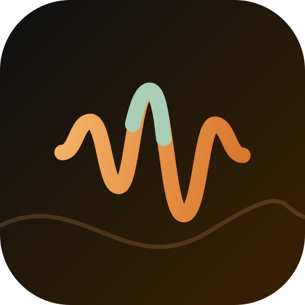
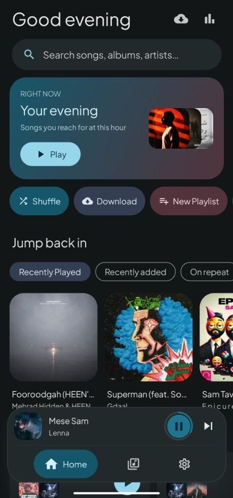
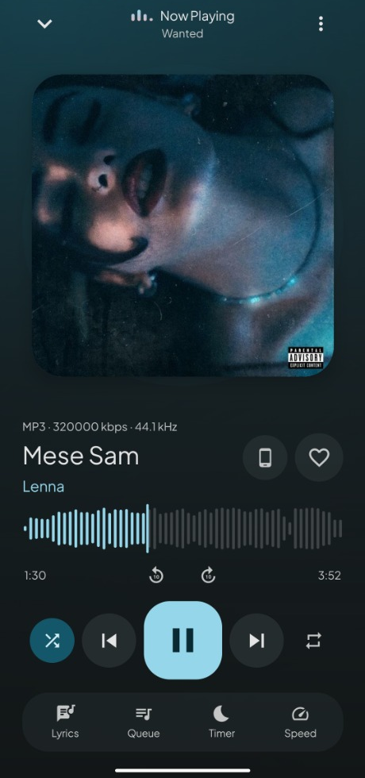
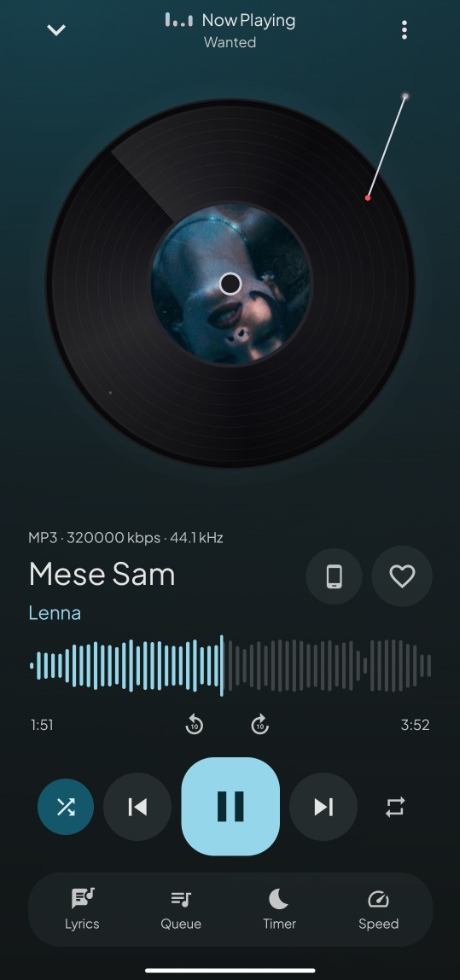
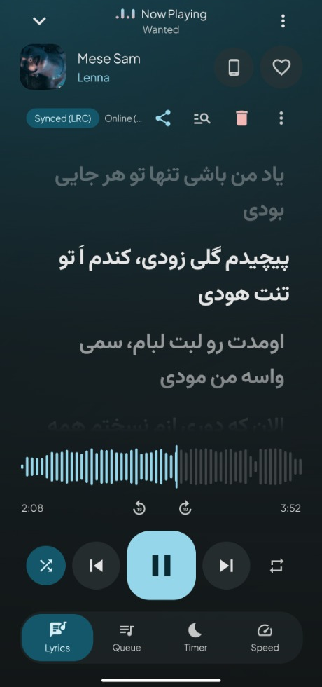
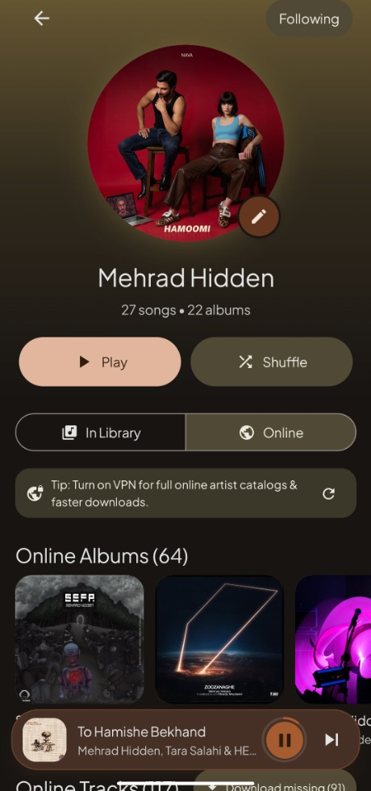
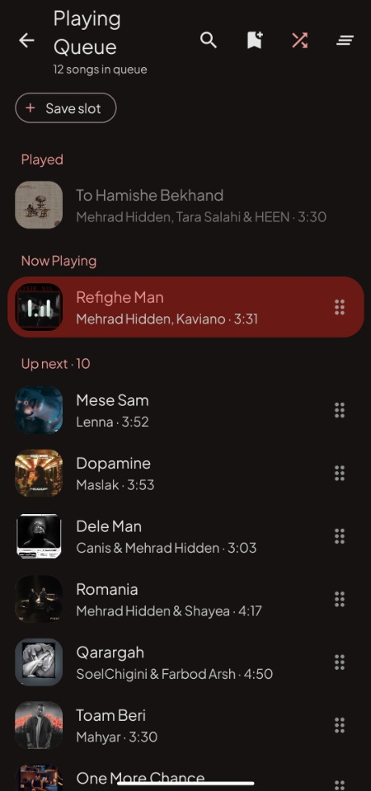
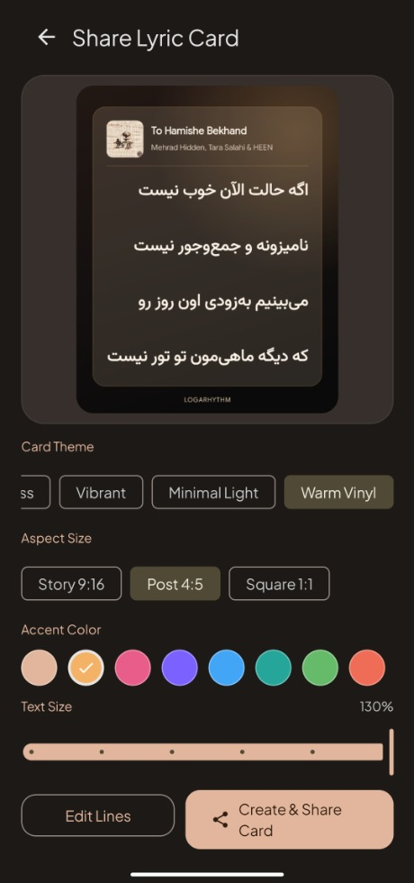
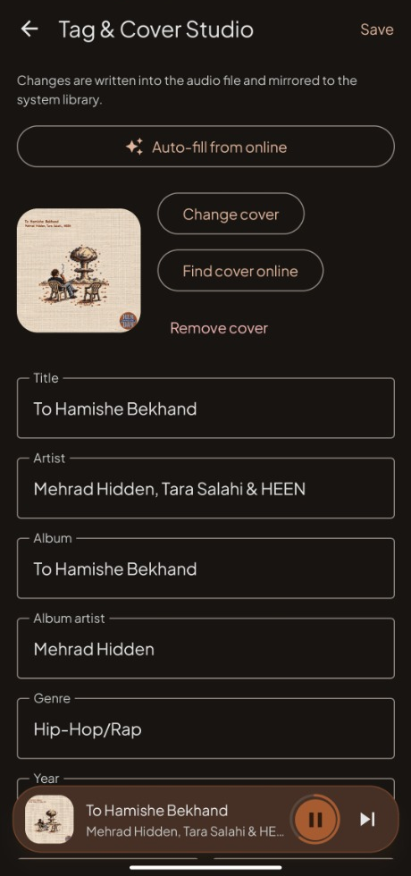
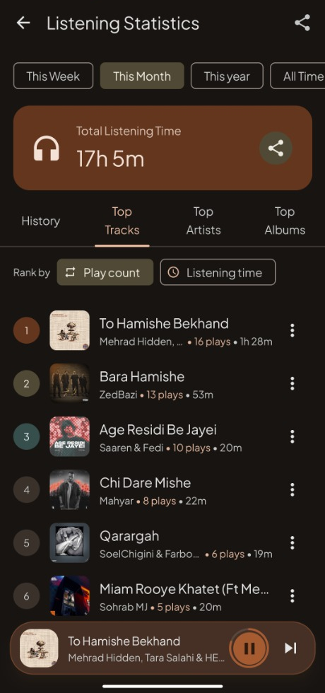

<div align="center">



# LogaRhythm

An offline-first Android music player for people who keep their own audio files.  
No ads, no accounts, no paywalls, and no behavioral tracking.

<a href="https://github.com/Yasinjahantigh/LogaRhythm-Android/releases/latest"></a>
<a href="https://github.com/Yasinjahantigh/LogaRhythm-Android/releases"></a>
<a href="https://logarhythm-installs.yasinjahantigh.workers.dev/stats"></a>
<a href="https://t.me/LogaRhythmApp"></a>


English · [فارسی](README.fa.md) · [All Features](docs/FEATURES.md)

</div>

---

<p align="center">
  
  
  
</p>
<p align="center">
  
  
  
</p>
<p align="center">
  
  
  
</p>

---

## About

I built LogaRhythm for listening to local MP3, FLAC, M4A, and OGG files without turning the app into a storefront or a heavy media manager. Everything you do with your local library stays on your device: playlists, queues, listening history, tags, and cached lyrics.

Online tools like music search, lyrics lookup, lyrics translation, Release Radar, and optional AI playlists only run when you use them.

## Main Features

### Playback & Queue
- **Vinyl mode & regular cover view**: Switch between album artwork and a turntable view where swiping slides the next record out of its sleeve, and holding or dragging the outer edge scrubs through the track.
- **Audio controls**: Crossfade, skip silence, ReplayGain (track/album + preamp), 5-band equalizer, bass boost, virtualizer, left/right balance, mono downmix, per-device Auto-EQ, speed & pitch controls, a **Slowed + Reverb** preset, A-B loop, and sleep timer (by minutes, track count, or end of track).
- **Queue & Audio Output**: Split queue (**Played**, **Now Playing**, **Up Next**) with drag reordering, swipe-to-remove, saved queues, swipe-right on any track to play next, endless auto-queue from your library, and an in-player audio output device picker.
- **Extras**: Double-tap cover sides to seek ±10s, long-audio position memory (>20 min), Car Mode (portrait and landscape), and 5 home screen widgets (`2x2`, `4x1`, `4x2`, `4x4` queue, `4x4` cover player).

### Home, Playlists & Online Discovery
- **Home**: Quick Picks 2-column grid, Right Now greeting card, jump-back shelves, daily mixes, mood mixes, and an optional Release Radar section for followed artists.
- **Playlists & Library**: Search inside any playlist, pin favorite playlists with a heart icon, exclude or whitelist folders, filter short clips/system audio, and enable Private Session to pause history tracking.
- **Downloads & Release Radar**: Search and download tracks or albums from MusicMan, Radio Javan, Deezer, Saavn, YouTube, SoundCloud, and Bandcamp with automatic latency/VPN source routing, `cookies.txt` support for YouTube, cover detail sheets, and an option to hide tracks already in your library.

### Lyrics, Translation & Share Cards
- **Lyrics**: Reads embedded tags and local `.lrc` files, or fetches synced/plain lyrics from LRCLIB, Genius, NetEase, Kugou, lyrics.ovh, or a custom HTTPS endpoint. Includes a line-by-line LRC timestamp editor and timing offset controls.
- **Free bilingual translation**: Translates lyrics line-by-line and caches them locally without needing an API key, plus a gentle ambient pulse during long instrumental breaks.
- **Share Card Studio**: Export track info, selected lyric lines, or listening reports as `1:1`, `4:5`, or `9:16` cards with live theme, color, and font-size previews.

### Library Tools & Listening Stats
- **Tag Editor & Batch Fixer**: Edit tags for MP3, FLAC, M4A, and OGG safely via temporary verified writes, clean noisy filenames in bulk and match metadata/covers from Deezer, iTunes, MusicBrainz, Radio Javan, and MusicMan, find duplicate tracks, or trim audio to make ringtones.
- **Offline Stats**: Top tracks, artists, and albums for any date range, ranked by play count or listening minutes.

### Themes, Fonts & Backups
- **Appearance**: Dynamic colors extracted from the playing album cover by default, plus 10 built-in presets, Material You, Pure Black OLED, custom accent/background wallpaper, and corner roundness options.
- **Typography & Languages**: Full English and Persian (RTL) interface, Vazirmatn default font, paired font presets, and custom `.ttf` / `.otf` font import. Adapted for phones, foldables, and tablets.
- **Backup & AI**: Single-file backup/restore (playlists, favorites, history, lyrics), M3U playlist import/export, and optional AI playlist generation (Gemini or any OpenAI-compatible API, off by default, key stored in Android KeyStore).

> See [docs/FEATURES.md](docs/FEATURES.md) for the complete breakdown.

## Installation

Requires **Android 8.0 (API 26)** or newer.

| Build | Best For | Download |
| :--- | :--- | :--- |
| **arm64-v8a** | Most modern Android phones | [Latest Release](https://github.com/Yasinjahantigh/LogaRhythm-Android/releases/latest) |
| **armeabi-v7a** | Older 32-bit Android phones | [All Releases](https://github.com/Yasinjahantigh/LogaRhythm-Android/releases) |
| **Universal APK** | Any Android ABI (larger file) | [Latest Release](https://github.com/Yasinjahantigh/LogaRhythm-Android/releases/latest) |

Direct APKs are also posted in the Telegram channel: [@LogaRhythmApp](https://t.me/LogaRhythmApp).

## Building from Source

Built with Kotlin, Jetpack Compose, Media3 ExoPlayer, Room, Hilt, and Glance.

Requirements: JDK 17 or 21, Android SDK Platform 35 (`minSdk = 26`, `targetSdk = 35`).

```bash
git clone https://github.com/Yasinjahantigh/LogaRhythm-Android.git
cd LogaRhythm-Android

# Debug build
./gradlew :app:assembleDebug

# Release build for Myket (strips REQUEST_INSTALL_PACKAGES and routes updates to Myket)
./gradlew :app:assembleRelease -PdistributionChannel=myket
```

## Privacy & Security

- **Local library**: Your songs, playlists, tags, and listening history stay on your device.
- **Transport & credentials**: Network calls enforce HTTPS with standard system TLS verification. Optional YouTube `cookies.txt` files are encrypted with Android KeyStore (AES-256-GCM) and only decrypted to a `0600` temp file that is deleted immediately after use.
- **Verified self-updates** *(GitHub builds)*: Checks GitHub Releases periodically, and checks host, package ID, and signing certificate before opening the installer. Myket builds remove `REQUEST_INSTALL_PACKAGES` and open Myket instead.
- **One-time install counter & optional diagnostics**: On first launch, the app records a single random `installId`, version, and channel (`github` or `myket`) with no device/hardware IDs and no recurring pings. Crash reports (sanitized of tokens, cookies, and file paths) and anonymous weekly summaries are controlled via the first-run consent sheet and **Settings → Privacy**. **Shake-to-Report** and **Settings → Suggestions** only send data when you tap Send.

## Support & License

If you find LogaRhythm useful, starring the repo helps a lot. Optional donations are available in **Settings → About** ([Daramet](https://daramet.com/yasinjahantigh) or TON).

LogaRhythm is free software licensed under the **GNU General Public License v3.0 (GPL-3.0)**. See [LICENSE](LICENSE), [NOTICE](NOTICE), and [THIRD_PARTY_NOTICES](THIRD_PARTY_NOTICES).
