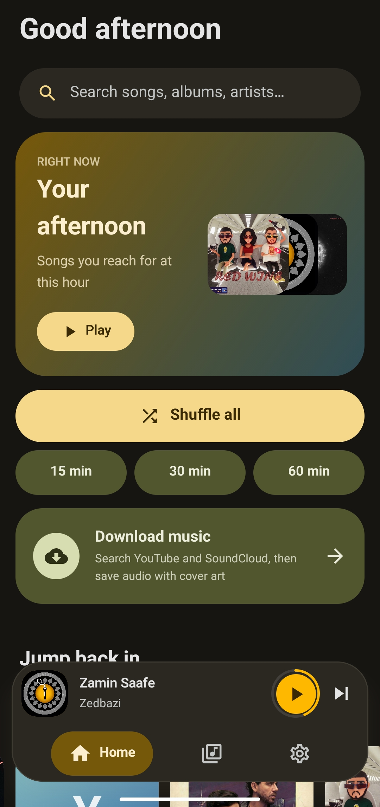
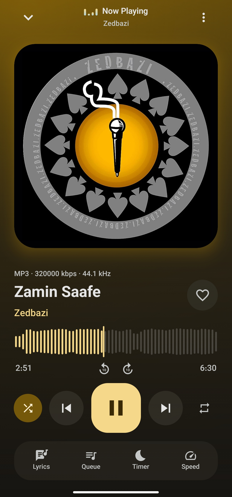
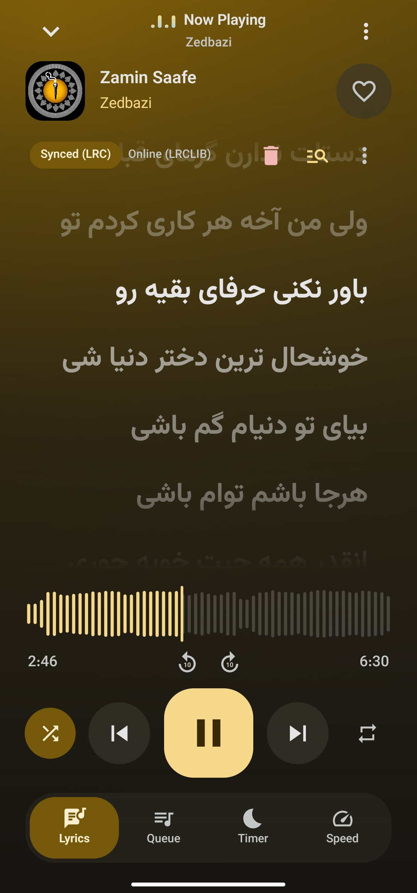
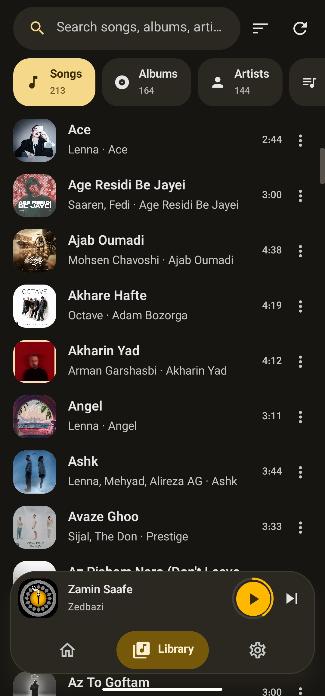

<div align="center">


# LogaRhythm

A local music player for Android.<br>
No account, no subscription. Your library stays on your phone.

<a href="https://github.com/Yasinjahantigh/LogaRhythm-Android/releases/latest"></a>
<a href="https://t.me/LogaRhythmApp"></a>


English · [فارسی](README.fa.md)

</div>

<p align="center">
  
  
  
  
</p>

## About

LogaRhythm plays the music that is already on your phone. Playlists, history, edited tags and lyrics are stored on the device, and nothing is uploaded anywhere. The only features that use the network are the ones you start yourself: online lyrics, music download, and the optional AI playlist.

## Features

**Playback**
- Cross-fade between songs, skip silence, per-song playback speed
- Sleep timer by minutes or by number of tracks
- Resume position saved for long tracks (over 20 minutes), such as podcasts and mixes
- Playback resumes when headphones reconnect
- Swipe the player to go to the next or previous track
- ReplayGain (track and album modes), preamp, 5-band equalizer, bass boost
- Home screen widget

**Lyrics**
- Reads lyrics embedded in the file, a `.lrc` file next to it, or fetches them online (LRCLIB, NetEase, Kugou, lyrics.ovh, Genius)
- Synced scrolling, timing adjustment, manual editing, import and export
- Wrong match? Search with your own title and artist and pick the right result
- Each online source can be turned off, and you can use your own lyrics server

**Tag and cover editor**
- Edit title, artist, album, album artist, genre, year, track and disc number, composer
- Change, crop or remove the cover art
- Supports MP3, FLAC, Ogg and M4A; changes are verified before the original file is replaced

**Library**
- Sort by title, artist, album, year, date added, duration, play count, last played, or random
- Filter by favorites, downloaded, or recently added
- Multi-select for queueing, playlists, favorites and hiding songs
- Duplicate finder, songs with missing tags, hidden songs, excluded folders
- Minimum track length, so voice notes and ringtones stay out
- Artist pages with top songs, albums and appearances; collaborations are split correctly (`feat.`, `&`, commas), and names like *Tyler, The Creator* stay intact

**Discovery**
- Smart mixes: recently added, recently played, most played, forgotten favorites, songs without lyrics, long songs, downloaded
- Daily mixes, mood-based queues, artist radio
- Listening stats by week, month or all time
- Save any mix or the current queue as a playlist

**Download**
- Search YouTube and SoundCloud and save songs with tags and cover art
- Download history with play, open and share

**Backup**
- Playlists, favorites, history and lyrics in a single backup file

**Appearance**
- Dark, light and true-black OLED themes, colors from the cover art or your wallpaper (Material You), or a custom accent
- Persian and English with full right-to-left support, switchable inside the app

**Optional AI playlist**
- Disabled by default. With your own OpenAI-compatible or Gemini API key, describe a mood and get a playlist built from your own library
- Only song metadata is sent, only when you tap Generate. The key is stored encrypted on the device

Technical details for each feature: [docs/FEATURES.md](docs/FEATURES.md)

## Install

Download the latest APK from [Releases](https://github.com/Yasinjahantigh/LogaRhythm-Android/releases/latest). Android 8.0 or newer is required.

Announcements and bug reports: [@LogaRhythmApp](https://t.me/LogaRhythmApp) on Telegram, or open an issue on GitHub.

## Build

```bash
git clone https://github.com/Yasinjahantigh/LogaRhythm-Android.git
cd LogaRhythm-Android
./gradlew :app:assembleDebug
```

Requires JDK 21 and Android SDK 36. On Windows use `gradlew.bat`.
If Google Maven is not reachable from your network, add `logarhythm.mirrors=true` to `local.properties`.

## License

Apache 2.0, see [LICENSE](LICENSE).

The download feature uses [youtubedl-android](https://github.com/junkfood02/youtubedl-android) and [yt-dlp](https://github.com/yt-dlp/yt-dlp) (GPL-3.0); released APKs bundle them. See [THIRD_PARTY_NOTICES](THIRD_PARTY_NOTICES).
The bundled [Vazirmatn](https://github.com/rastikerdar/vazirmatn) font is licensed under SIL OFL 1.1, see [OFL.txt](app/src/main/assets/OFL.txt).
