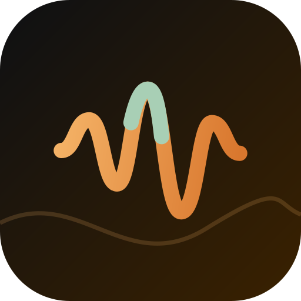
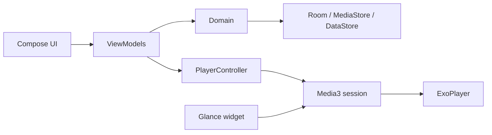

<div align="center">



<h1>LogaRhythm</h1>

<p><strong>A private, offline-first music player for Android.</strong></p>

<p><a href="#english">English</a> · <a href="#فارسی">فارسی</a></p>

<p>
  
  
  
  
  <a href="https://github.com/Yasinjahantigh/LogaRhythm-Android/actions/workflows/ci.yml"></a>
</p>

</div>

---

## English

LogaRhythm turns the music files already on your phone into a library that feels personal, without sending that library anywhere. It plays local audio, keeps listening history on the device, and adds the things that make daily listening better: synced lyrics, a careful tag editor, ReplayGain, daily mixes and a home-screen widget.

No account. No ads. No analytics.

> This repository contains the native **Android app**. It is a separate codebase from the LogaRhythm web player.

### Why LogaRhythm

- **Local by design.** The library index, playlists, lyrics and listening history live in Room and DataStore on the device.
- **Lyrics that travel with the file.** Embedded tags and companion `.lrc` files are read first; online lookup is optional and can be disabled.
- **A tag editor that checks its work.** MP3, FLAC, M4A/MP4 and Ogg Vorbis/Opus are rewritten in a staged copy, re-parsed, verified byte-for-byte, and restored if anything fails.
- **Playback that respects the recording.** ReplayGain (track and album), a user preamp, a 5-band equalizer, bass boost and virtualizer.
- **Built for both scripts.** English and Persian UI, RTL layouts, Persian letter normalization in search, and localized digits.
- **Material 3 with a point of view.** Album-art color theming, Material You wallpaper colors, and the warm **Ink & Ember** palette.

### Features

| Area | What you get |
| :--- | :--- |
| **Library** | Songs, albums, artists, genres, folders and playlists; favorites; fast scroll; custom sorting; hidden songs; excluded folders; duplicate finder; missing-tag view |
| **Playback** | Media3 background playback, media notification, draggable queue, shuffle and repeat, sleep timer by minutes or tracks, playback speed, cross-song fade, skip silence, resume on headphones |
| **Lyrics** | Embedded ID3/Vorbis/MP4 lyrics, companion `.lrc`, import and export, manual entry, clipboard paste, scrolling synced lyrics, timing offset, mismatch detection, online candidates |
| **Tag editing** | Title, artist, album and genre for MP3 (ID3v2.2–2.4), FLAC, M4A/MP4 and Ogg Vorbis/Opus, with staged writes and rollback |
| **Discovery** | Daily mixes, mood queues, artist radio, time-of-day suggestions and listening sessions, all computed on device |
| **Statistics** | Play counts, listening time, top tracks, artists and albums for the week, month or all time |
| **Personalization** | Album-art and wallpaper color themes, light/dark/system mode, corner roundness, compact mini player, English and Persian |
| **Widget** | A Glance home-screen widget with artwork and playback controls |
| **Data** | Full backup and restore, plus M3U/M3U8 playlist import and export |

### Design

The interface is built on the **Ink & Ember** palette: warm ink surfaces, an amber accent, slate and sage supporting tones. Cover art drives the color scheme when you want it to; Material You takes over when you prefer the wallpaper.

`#0E1013` Ink · `#F4B266` Ember · `#B9C8D6` Slate · `#A8CFB5` Sage

### Tech stack

| Layer | Tools |
| :--- | :--- |
| UI | Jetpack Compose, Material 3, Navigation Compose, Glance |
| Playback | Media3 / ExoPlayer, MediaSessionService |
| Data | Room, DataStore, MediaStore |
| Async | Kotlin Coroutines, Flow |
| DI | Hilt |
| Images | Coil |
| Build | Gradle, Android Gradle Plugin 8.13, JDK 21 |

### Architecture



The code follows a `UI -> domain <- data` dependency direction. Screens observe ViewModels; the domain layer exposes repository and source interfaces; Room, MediaStore, DataStore and Media3 provide persistence and playback. The tag engines are pure JVM code, so they are tested without an emulator.

### Project layout

```text
app/src/main/java/com/yasinjahantigh/logarhythm/
├── core/       Hilt modules, library sync, shared utilities
├── data/       Room, repositories, lyrics providers, tag engines, backup
├── domain/     Models and pure logic (mixes, stats, lyrics, ReplayGain)
├── feature/    Compose screens and ViewModels
├── playback/   Media3 service, queue, equalizer, ReplayGain
├── ui/         Theme, navigation, shared components
└── widget/     Glance home-screen widget
app/src/test/   JVM unit tests
docs/           Release guide
```

### Build

Requirements:

- JDK 21
- Android SDK platform 36 and Build Tools 36.1.0
- The Gradle wrapper is included; a separate Gradle installation is not needed

```bash
git clone https://github.com/Yasinjahantigh/LogaRhythm-Android.git
cd LogaRhythm-Android

./gradlew :app:assembleDebug
./gradlew :app:testDebugUnitTest
./gradlew :app:lintDebug
```

On Windows, use `gradlew.bat`. The debug APK is written to `app/build/outputs/apk/debug/`. You can also open the project directly in Android Studio.

If Google Maven is unreachable on your network, add `logarhythm.mirrors=true` to `local.properties` to enable the fallback mirrors.

### Signed releases

Releases are built by the **Build and release APK** workflow on a `v*` tag or by manual dispatch. The workflow runs the unit tests, builds the release APK, verifies its signature with `apksigner`, and attaches it to a GitHub release.

Signing setup and the required repository secrets are documented in [docs/RELEASING.md](docs/RELEASING.md).

### Privacy

- No account, advertising, analytics or telemetry.
- Library metadata, playlists, lyrics and listening history stay on the device.
- Android cloud backup is disabled; use the in-app backup file when you change devices.
- The only network features are lyrics-related: optional online lookup, which sends the song title, artist and duration to the selected providers, and a Google search shortcut you trigger yourself. Online lookup can be turned off in Settings.
- File edits require explicit system consent, and every write is verified before it is kept.

### Contributing

Bug reports and focused pull requests are welcome. For larger changes, please open an issue first so the direction can be discussed.

### License

Apache License 2.0. See [LICENSE](LICENSE) and [NOTICE](NOTICE).

---

<div dir="rtl">

## فارسی

**یک پخش‌کنندهٔ موسیقی خصوصی و آفلاین برای اندروید.**

LogaRhythm فایل‌های صوتی‌ای را که همین حالا روی گوشی‌تان دارید به یک کتابخانهٔ شخصی تبدیل می‌کند، بدون اینکه این کتابخانه را جایی بفرستد. پخش محلی، تاریخچهٔ شنیدن روی دستگاه، و امکاناتی که گوش‌دادن روزمره را بهتر می‌کنند: متن ترانهٔ همگام، ویرایشگر دقیق تگ‌ها، ReplayGain، میکس‌های روزانه و ویجت صفحهٔ اصلی.

بدون حساب کاربری، تبلیغات یا ردیابی.

> این مخزن شامل **اپلیکیشن اندروید** است و از پخش‌کنندهٔ وب LogaRhythm جدا است.

### چرا LogaRhythm

- **محلی از پایه.** فهرست کتابخانه، پلی‌لیست‌ها، متن ترانه‌ها و تاریخچهٔ شنیدن در Room و DataStore روی دستگاه می‌مانند.
- **ترانه‌ای که همراه فایل می‌ماند.** اول تگ‌های داخل فایل و فایل کنارِ `.lrc` خوانده می‌شوند؛ جستجوی آنلاین اختیاری است و می‌توانید خاموشش کنید.
- **ویرایشگری که کار خودش را بررسی می‌کند.** فایل‌های MP3، FLAC، M4A/MP4 و Ogg Vorbis/Opus در یک نسخهٔ موقت بازنویسی، دوباره خوانده و بایت‌به‌بایت بررسی می‌شوند؛ اگر چیزی اشتباه باشد، فایل اصلی برمی‌گردد.
- **پخشی که به صدای ضبط‌شده احترام می‌گذارد.** ReplayGain برای آهنگ و آلبوم، پیش‌تقویت دستی، اکولایزر پنج‌باندی، Bass Boost و Virtualizer.
- **ساخته‌شده برای فارسی و انگلیسی.** رابط دوزبانه، چیدمان راست‌به‌چپ، یکسان‌سازی حروف فارسی در جستجو و اعداد بومی‌شده.
- **متریال ۳ با شخصیت.** رنگ‌گرفته از کاور آلبوم، رنگ‌های والپیپر Material You و پالت گرم **Ink & Ember**.

### امکانات

| بخش | چه چیزی دارید |
| :--- | :--- |
| **کتابخانه** | آهنگ، آلبوم، هنرمند، سبک، پوشه و پلی‌لیست؛ موردعلاقه‌ها؛ اسکرول سریع؛ مرتب‌سازی دلخواه؛ مخفی‌کردن آهنگ؛ مستثنی‌کردن پوشه؛ یافتن تکراری‌ها؛ نمایش تگ‌های ناقص |
| **پخش** | پخش پس‌زمینه با Media3، اعلان رسانه، صف قابل‌جابه‌جایی، شافل و تکرار، تایمر خواب بر اساس دقیقه یا ترک، سرعت پخش، محوشدن بین آهنگ‌ها، پرش از سکوت، ادامهٔ پخش با اتصال هدفون |
| **متن ترانه** | متن داخل تگ ID3/Vorbis/MP4، فایل `.lrc` کنار آهنگ، ورود و خروج، نوشتن دستی، چسباندن از کلیپ‌بورد، اسکرول همگام، تنظیم زمان، تشخیص ناهماهنگی و گزینه‌های آنلاین |
| **ویرایش تگ** | عنوان، هنرمند، آلبوم و سبک برای MP3 (ID3v2.2–2.4)، FLAC، M4A/MP4 و Ogg Vorbis/Opus، با نوشتن مرحله‌ای و بازگردانی |
| **کشف موسیقی** | میکس‌های روزانه، صف‌های حال‌وهوایی، رادیوی هنرمند، پیشنهاد بر اساس ساعت روز و جلسه‌های شنیدن، همه روی دستگاه |
| **آمار** | تعداد پخش، زمان شنیدن و آهنگ‌ها، هنرمندان و آلبوم‌های برتر برای این هفته، این ماه یا همهٔ زمان‌ها |
| **شخصی‌سازی** | تم رنگی از کاور یا والپیپر، حالت روشن/تیره/سیستم، گردی گوشه‌ها، مینی‌پلیر جمع‌وجور، انگلیسی و فارسی |
| **ویجت** | ویجت صفحهٔ اصلی با Glance، کاور و کنترل پخش |
| **داده‌ها** | پشتیبان‌گیری و بازیابی کامل، به‌همراه ورود و خروج پلی‌لیست‌های M3U/M3U8 |

### طراحی

رابط بر پایهٔ پالت **Ink & Ember** ساخته شده است: سطوح جوهری گرم، لهجهٔ کهربایی و رنگ‌های کمکی سربی و مریم‌گلی. اگر بخواهید، رنگ کاور آلبوم تم را می‌سازد؛ اگر ترجیح دهید، Material You از والپیپر استفاده می‌کند.

`#0E1013` جوهر · `#F4B266` کهربا · `#B9C8D6` سربی · `#A8CFB5` مریم‌گلی

### فناوری‌ها

| لایه | ابزار |
| :--- | :--- |
| رابط کاربری | Jetpack Compose، Material 3، Navigation Compose، Glance |
| پخش | Media3 / ExoPlayer، MediaSessionService |
| داده | Room، DataStore، MediaStore |
| هم‌روندی | Kotlin Coroutines، Flow |
| تزریق وابستگی | Hilt |
| تصاویر | Coil |
| ساخت | Gradle، Android Gradle Plugin 8.13، JDK 21 |

ساختار کد از جهت وابستگی `UI -> domain <- data` پیروی می‌کند. صفحه‌ها ViewModel را مشاهده می‌کنند، لایهٔ domain رابط repository و source را تعریف می‌کند، و Room، MediaStore، DataStore و Media3 مسئول ذخیره‌سازی و پخش هستند. موتورهای تگ کد خالص JVM هستند و بدون شبیه‌ساز تست می‌شوند. نمودار معماری در بخش انگلیسی آمده است.

### ساخت و اجرا

پیش‌نیازها:

- JDK 21
- Android SDK platform 36 و Build Tools 36.1.0
- Gradle wrapper همراه پروژه است و نصب جداگانهٔ Gradle لازم نیست

```bash
git clone https://github.com/Yasinjahantigh/LogaRhythm-Android.git
cd LogaRhythm-Android

./gradlew :app:assembleDebug
./gradlew :app:testDebugUnitTest
./gradlew :app:lintDebug
```

در ویندوز از `gradlew.bat` استفاده کنید. خروجی APK دیباگ در مسیر `app/build/outputs/apk/debug/` ساخته می‌شود. می‌توانید پروژه را مستقیم در Android Studio هم باز کنید.

اگر Google Maven در شبکهٔ شما در دسترس نیست، در فایل `local.properties` مقدار `logarhythm.mirrors=true` را اضافه کنید تا از آینه‌های جایگزین استفاده شود.

### انتشار امضاشده

نسخه‌های انتشار با گردش‌کار **Build and release APK** روی تگ `v*` یا با اجرای دستی ساخته می‌شوند. گردش‌کار تست‌ها را اجرا می‌کند، APK نسخهٔ نهایی را می‌سازد، امضایش را با `apksigner` بررسی می‌کند و آن را به یک GitHub Release پیوست می‌کند.

راه‌اندازی امضا و Secretهای لازم در [docs/RELEASING.md](docs/RELEASING.md) توضیح داده شده است.

### حریم خصوصی

- بدون حساب کاربری، تبلیغات، تحلیل رفتار یا تله‌متری.
- اطلاعات کتابخانه، پلی‌لیست‌ها، متن ترانه‌ها و تاریخچهٔ شنیدن روی دستگاه می‌مانند.
- پشتیبان‌گیری ابری اندروید خاموش است؛ برای تغییر گوشی از فایل پشتیبان داخل اپ استفاده کنید.
- تنها قابلیت‌های شبکه‌ای مربوط به متن ترانه هستند: جستجوی اختیاری آنلاین که عنوان آهنگ، هنرمند و مدت آن را به سرویس‌های انتخابی می‌فرستد، و میان‌بر جستجو در گوگل که خودتان اجرا می‌کنید. جستجوی آنلاین را می‌توانید از تنظیمات خاموش کنید.
- ویرایش فایل‌ها فقط با اجازهٔ صریح سیستم انجام می‌شود و هر نوشتن پیش از نگه‌داشتن بررسی می‌شود.

### مشارکت

گزارش باگ و پول‌ریکوئست‌های متمرکز خوش‌آمدند. برای تغییرهای بزرگ‌تر اول یک Issue باز کنید تا دربارهٔ مسیر کار صحبت شود.

### مجوز

Apache License 2.0. فایل‌های [LICENSE](LICENSE) و [NOTICE](NOTICE) را ببینید.

</div>
